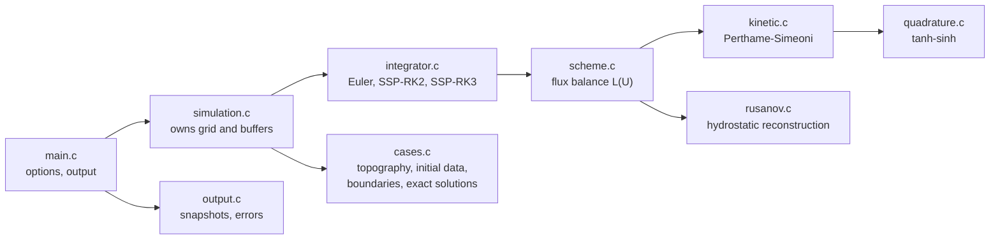

# Implementation

## Code organisation

| File | Responsibility |
|---|---|
| `grid.c` | uniform grid, cell centres, state arrays $h$, $hu$, $Z$ |
| `cases.c` | test cases: bottom, initial state, boundary conditions, exact solutions |
| `scheme.c` | the spatial operator: one pass over the interfaces, flux balance per cell |
| `kinetic.c` | interface fluxes of the kinetic scheme with reflections |
| `rusanov.c` | interface fluxes of the reference scheme |
| `quadrature.c` | tanh-sinh quadrature for $II^q_3$ |
| `integrator.c` | explicit time integrators in Shu-Osher form |
| `simulation.c` | one run: creation, time stepping, destruction |
| `output.c` | snapshot files, error norms |
| `main.c` | command-line options, summary |

Schemes, integrators and cases are each a table of entries looked up by name, so
adding one does not touch the rest of the code (see [Contributing](contributing.md)).

## Grid

The domain $[x_{\min}, x_{\max}]$ is divided into $n$ cells of width
$\Delta x = (x_{\max} - x_{\min})/n$. Interior cells are $i = 1, \dots, n$, with
centres $x_i = x_{\min} + (i - \tfrac12)\Delta x$; cells $0$ and $n + 1$ are ghost
cells filled by the boundary conditions.

The bottom is stored as **cell averages**, $Z_i = \frac{1}{\Delta x}\int_{C_i} Z(x)\,dx$,
as in Section 3.1 of the paper. Each topography is defined by its primitive, so the
averages are exact.

## Sign convention for the bottom jump

The jump is always the one **seen from the cell that owns the flux**:

$$
\Delta Z_{i+1/2} = Z_{i+1} - Z_i, \qquad \Delta Z_{i-1/2} = Z_{i-1} - Z_i .
$$

A positive jump is a step up for particles leaving cell $i$. This is the convention
the proof of the lake-at-rest property uses ($\Delta Z_{i-1/2} = h_i - h_{i-1}$ at rest).

## Interface fluxes

Both schemes implement the same interface: given the states of the two cells on each
side of an interface, return the flux **seen by the left cell** ($F^-$) and the flux
**seen by the right cell** ($F^+$). `scheme_flux_balance` visits each of the $n + 1$
interfaces once and forms

$$
D_i = F^-_{i+1/2} - F^+_{i-1/2}, \qquad \frac{dU_i}{dt} = -\frac{D_i}{\Delta x}.
$$

For the kinetic scheme, only $F^-$ is coded. $F^+$ is obtained by the **mirror
symmetry** $x \to -x$: the right cell becomes the "own" cell of a mirrored problem
in which velocities change sign. The mass flux changes sign under the mirror and the
momentum flux (a second moment in $\xi$) does not:

$$
F^{+}_{i+1/2}(U_i, U_{i+1}) = \begin{pmatrix} -1 & 0 \\ 0 & 1 \end{pmatrix}
F^{-}\big(\tilde U_{i+1}, \tilde U_i\big), \qquad \tilde U = (h, -hu, Z).
$$

This halves the code and guarantees that left and right fluxes are computed
consistently.

## The integral II3q

$II^q_3$ has no elementary primitive. When the bottom steps down towards the own
cell ($K^+ < 0$), the radicand $(\omega + Fr)^2 + K^+$ vanishes exactly at the upper
bound $\beta = -\sqrt{(K^+)_-} - Fr$, and $s(\omega) = \sqrt{1 - \omega^2}$ vanishes at
the lower bound $-1$. The integrand therefore has **square-root singularities at both
ends**.

The paper suggests a repeated midpoint rule. Because of the singularities it
converges only like $N^{-3/2}$, and since the lake-at-rest property relies on exact
integrals, the quadrature error shows up directly as spurious currents:

| Quadrature of $II^q_3$ | max $\lvert hu \rvert$ after 1.5 s on the lake at rest |
|---|---|
| midpoint, $N = 100$ | $1.8 \times 10^{-3}$ |
| midpoint, $N = 1000$ | $5.2 \times 10^{-5}$ |
| midpoint, $N = 10\,000$ | $\approx 2 \times 10^{-6}$ |
| tanh-sinh, 113 nodes | $1.4 \times 10^{-14}$ |

The midpoint figures were measured on the 2013 code in double precision with π
corrected (1000 cells); the last line is the current code.

The code uses a **tanh-sinh** (double exponential) rule, which converges
exponentially even with algebraic endpoint singularities. The integrand receives the
distances to both endpoints, computed without cancellation, and the radicand is
expanded around $\beta$ so that its exact zero is preserved. Against a 30-digit
reference the relative error is below $2 \times 10^{-15}$.

## A sign in the paper

The closed form of $II^h_3$ printed in the paper ends with
$-\tfrac12 Fr\,\beta\sqrt{1-\beta^2}$. Integrating $\sqrt{1 - \omega^2}$ over
$[-1, \beta]$ gives $+\tfrac12 Fr\,\beta\sqrt{1-\beta^2}$, which is what the code uses
and what matches the flux definition (3.5) numerically.

## Dry cells

Cells with $h \le 10^{-10}$ are treated as dry: zero velocity, zero Froude number,
and no contribution to the fluxes. Both schemes keep $h \ge 0$ under their CFL
condition; after each stage the code only removes round-off level negative values
and the momentum of cells that just dried out.

## Time integration

The semi-discrete system $dU/dt = L(U)$ is advanced by explicit integrators written
in Shu-Osher form,

$$
U^{(0)} = U^n, \qquad
U^{(k)} = a_k U^n + b_k\left(U^{(k-1)} + \Delta t\, L(U^{(k-1)})\right), \qquad
U^{n+1} = U^{(s)},
$$

| Integrator | $(a_k, b_k)$ | Order |
|---|---|---|
| `euler` | $(0, 1)$ | 1 |
| `ssp-rk2` | $(0, 1),\ (\tfrac12, \tfrac12)$ | 2 |
| `ssp-rk3` | $(0, 1),\ (\tfrac34, \tfrac14),\ (\tfrac13, \tfrac23)$ | 3 |

With $a_k, b_k \ge 0$ and $a_k + b_k = 1$, every stage is a convex combination of
forward Euler steps (strong-stability-preserving methods with coefficient 1).
Positivity, the lake at rest and conservation therefore carry over from Euler under
the same CFL condition. The time step comes from the CFL condition (3.9) with a
default CFL number of 0.95.

Forward Euler is the scheme of the paper and remains the default: with a first-order
space discretisation it is also the most accurate at large CFL numbers (see
[Validation](validation.md#forward-euler-versus-runge-kutta)).

## The Rusanov reference scheme

The reference scheme combines the Rusanov (local Lax-Friedrichs) flux with the
hydrostatic reconstruction of Audusse et al. (2004). At each interface the heights
are reconstructed above the highest of the two bottoms,

$$
Z^* = \max(Z_i, Z_{i+1}), \qquad
h_i^* = (h_i + Z_i - Z^*)_+, \qquad
h_{i+1}^* = (h_{i+1} + Z_{i+1} - Z^*)_+,
$$

the Rusanov flux $\mathcal{F}$ is evaluated on the reconstructed states, and each
side adds the pressure correction

$$
F^-_{i+1/2} = \mathcal{F} + \begin{pmatrix} 0 \\ \tfrac{g}{2}\left(h_i^2 - h_i^{*2}\right) \end{pmatrix},
\qquad
F^+_{i+1/2} = \mathcal{F} + \begin{pmatrix} 0 \\ \tfrac{g}{2}\left(h_{i+1}^2 - h_{i+1}^{*2}\right) \end{pmatrix}.
$$

It is positive and preserves the lake at rest, dry areas included. Its time step uses
the wave speed $\lvert u\rvert + \sqrt{gh}$ with a default CFL number of 0.9.

## Boundary conditions

| Kind | Ghost cells | Used by |
|---|---|---|
| free (transmissive) | copy of the neighbouring cell | lakes at rest, dam breaks |
| wall | copy, with $hu$ reversed | `sloshing` |
| periodic | copy of the opposite end | `periodic-pulse` |
| inflow / outflow | left: imposed discharge $q$, height copied; right: imposed height $h_{\text{out}}$ while the outflow is subcritical, copy once it is supercritical | flows over the bump |

The outflow condition follows the characteristics: at a subcritical outlet one wave
enters the domain and the downstream height must be imposed; at a supercritical
outlet none does and imposing it would be wrong. With a plain copy instead, any
subcritical steady state is compatible with the boundary and the transcritical flow
never develops: water piles up downstream.

The bottom of the ghost cells follows the same rule, so that a lake at rest stays at
rest across the boundary.

## History

The 2013 code had the same scheme but several bugs, found and fixed in 2026:
a value of π truncated to 3.1415 (it broke the lake-at-rest property by mixing with
`acos`), an error norm multiplied by $\Delta x$, a Rusanov scheme without topography
that produced NaN on dry beds, three different cell-position formulas, and periodic
boundaries one step behind. The pull requests on GitHub give the details and the
measurements.
