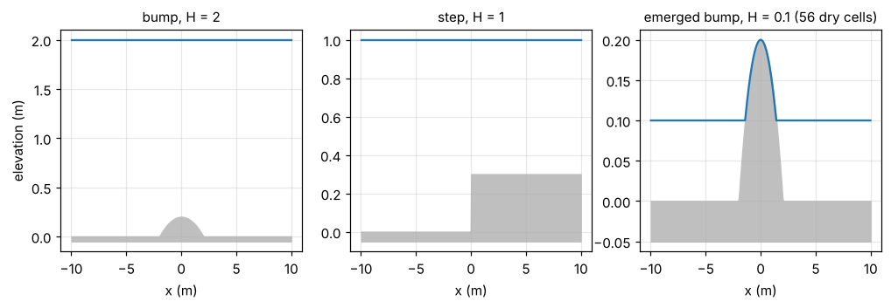
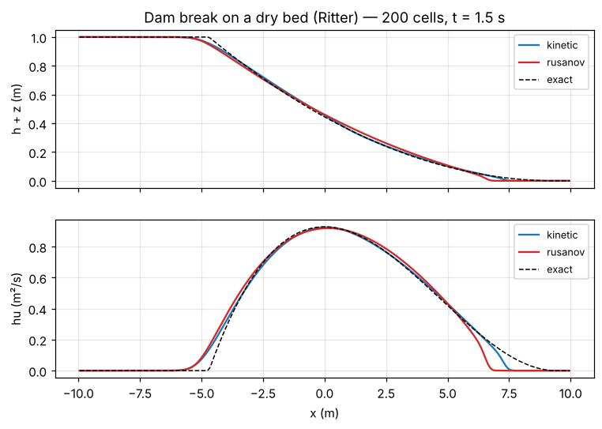
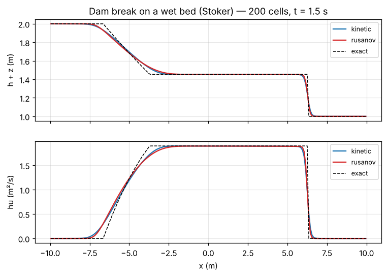
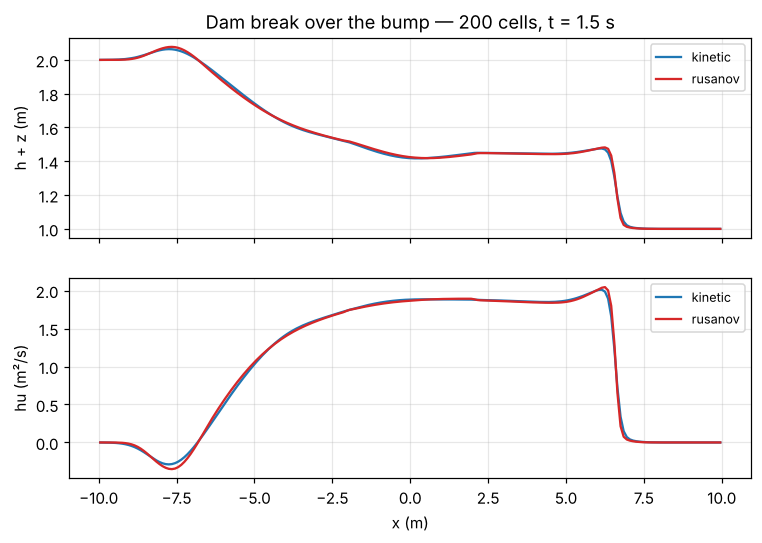
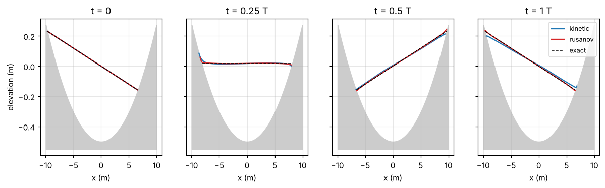
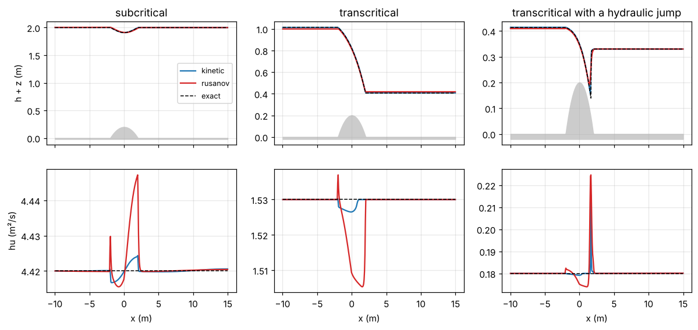
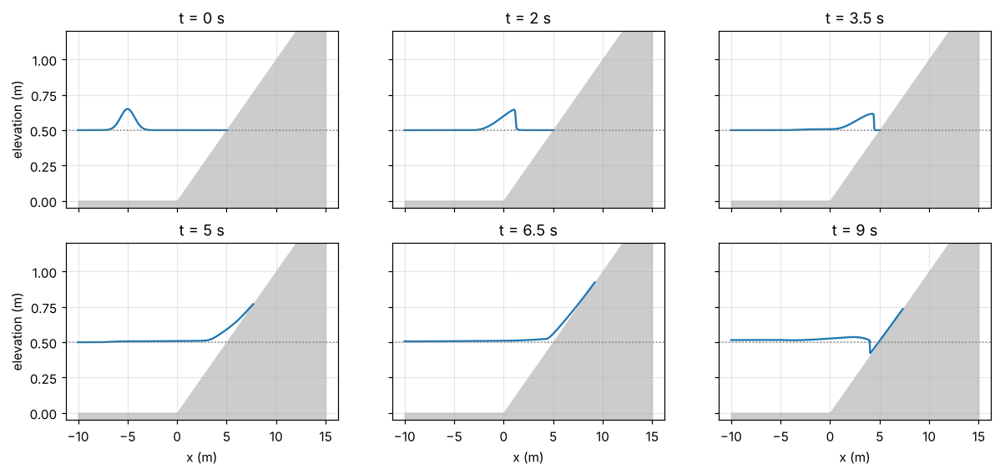
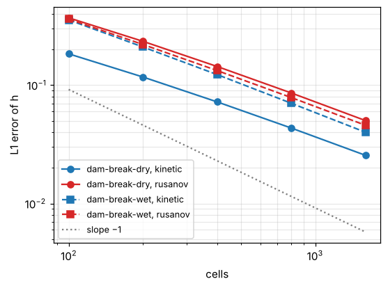
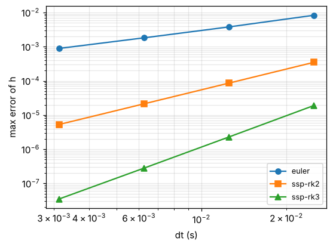
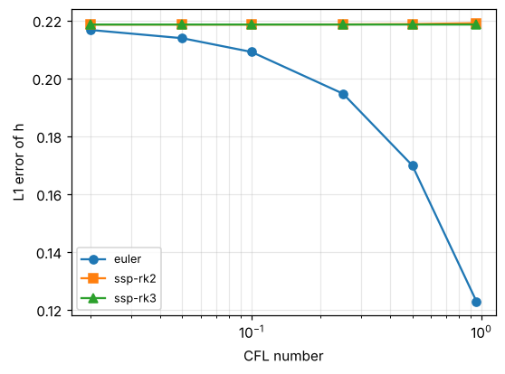

# Validation

Every number on this page can be regenerated with

```sh
make && python3 scripts/make_doc_figures.py
```

and most of them are enforced by the test suite (`make test`).

## The fluxes against the paper's definitions

The strongest check does not use the code's formulas at all. A Python reference
builds the interface densities (3.7)-(3.8) directly from the Maxwellian $\chi$,
integrates their moments in $\xi$ with an adaptive quadrature, and compares them
with the fluxes returned by the C code on random pairs of states: dry cells,
supercritical flows and steps in both directions.

| Check | Agreement |
|---|---|
| kinetic fluxes $F^-$ and $F^+$ against (3.5)-(3.8) | $< 10^{-10}$ (relative) |
| mass flux single-valued (Remark 3.1) | $< 10^{-13}$ |
| momentum defect $= g\,\Delta Z\, h^{\text{jump}}$ (Ersoy 2026, Prop. 4.1) | $3 \times 10^{-14}$ |
| $II^q_3$ against a 30-digit reference | $< 2 \times 10^{-15}$ (relative) |

## Lake at rest



Maximum deviation from the initial state after 1.5 s, 1000 cells, forward Euler:

| Case | Scheme | max $\lvert h - h_0 \rvert$ | max $\lvert hu \rvert$ |
|---|---|---|---|
| bump, $H = 2$ | kinetic | $3.1 \times 10^{-15}$ | $1.4 \times 10^{-14}$ |
| | Rusanov | $1.1 \times 10^{-15}$ | $5.6 \times 10^{-15}$ |
| step, $H = 1$ | kinetic | $2.2 \times 10^{-16}$ | $7.6 \times 10^{-16}$ |
| | Rusanov | $1.1 \times 10^{-16}$ | $5.1 \times 10^{-16}$ |
| emerged bump, $H = 0.1$ | kinetic | $9.8 \times 10^{-17}$ | $3.8 \times 10^{-17}$ |
| | Rusanov | $2.1 \times 10^{-17}$ | $1.3 \times 10^{-17}$ |

Both schemes keep the lake at rest to round-off, including the case where the top
of the bump is dry. The tests require $10^{-12}$ for all three integrators.

## Dam breaks against exact solutions

**Dry bed (Ritter).** The kinetic scheme follows the dry front better than Rusanov,
whose front lags behind the exact one:



**Wet bed (Stoker).** The rarefaction, the middle state and the shock are captured
by both schemes:



**Over the bump**, with no exact solution: the flow over the obstacle and the waves
it reflects.



## Moving shorelines: Thacker's bowl

In a parabolic bowl the free surface stays a plane that rocks back and forth, with
a velocity uniform over the wet region (Thacker, 1981). Both shorelines move up and
down the dry slopes, which makes it one of the hardest tests for wet/dry fronts.



L1 error of $h$ after one period (16.05 s):

| Scheme | 100 | 200 | 400 | 800 | 1600 |
|---|---|---|---|---|---|
| kinetic | 0.298 | 0.171 | 0.0945 | 0.0512 | 0.0272 |
| Rusanov | 0.0476 | 0.0233 | 0.0134 | 0.00743 | 0.00396 |

Both schemes converge (order about 0.9) and keep $h \ge 0$ and the mass to
round-off. The kinetic scheme has a larger error constant, and the reason is
instructive. Fitting the free surface on 400 cells:

| | tilt at $T/2$ | $u$ at $T/2$ | tilt at $T$ | $u$ at $T$ |
|---|---|---|---|---|
| exact | +0.02395 | 0 | −0.02395 | 0 |
| kinetic | +0.02319 | +0.0001 | −0.02272 | −0.0006 |
| Rusanov | +0.02370 | +0.0086 | −0.02375 | −0.0146 |

The kinetic scheme gets the **phase** right but **damps the amplitude** by about
5% per period; Rusanov keeps the amplitude but drifts in phase. The damping does not
depend on the time integrator or the CFL number, so it is the numerical dissipation
of the kinetic fluxes over a smooth slope, consistent with its discrete entropy
inequality.

## Steady flows over a bump

Water enters on the left with a fixed discharge $q$ and settles into a steady flow
over the bump (Goutal & Maurel, 1997; SWASHES, 2013). Along each smooth part of the
flow the discharge is uniform and the Bernoulli head
$q^2/(2gh^2) + h + Z$ is constant. Three regimes:

- **subcritical** ($q = 4.42$, outlet height 2): the surface dips over the bump;
- **transcritical** ($q = 1.53$): the flow accelerates over the bump, becomes
  critical at the crest and supercritical downstream;
- **with a hydraulic jump** ($q = 0.18$, outlet height 0.33): supercritical after the
  crest, then a stationary jump back to the subcritical outlet height, located by the
  Rankine-Hugoniot condition (x = 1.666).



After 100 to 200 s of simulated time, 400 cells:

| Case | Scheme | L1 error of $h$ | max deviation of the discharge |
|---|---|---|---|
| subcritical | kinetic | 0.039 | 0.10% |
| | Rusanov | 0.067 | 0.62% |
| transcritical | kinetic | 0.048 | 0.23% |
| | Rusanov | 0.305 | 1.6% |
| hydraulic jump | kinetic | 0.016 | 20% (in the jump cell) |
| | Rusanov | 0.066 | 25% (in the jump cell) |

The kinetic scheme is the more accurate of the two on all three regimes. Its
discharge stays almost uniform across the bump, where Rusanov's varies by up to
1.6%, and on the transcritical flow Rusanov's upstream level is visibly too low.
Both place the jump within two cells of its exact position, and the numerical jump
converges to it as the mesh is refined.

The outlet boundary condition matters here: the downstream height is imposed only
while the outflow is subcritical (see
[Implementation](implementation.md#boundary-conditions)).

## Run-up on a beach

A wave travelling to the right steepens into a bore, runs up a dry beach of slope
0.1, and flows back down. There is no exact solution.



Maximum run-up above still water, and lowest shoreline position during the backwash
(initial shoreline at x = 5):

| Cells | kinetic run-up | Rusanov run-up | kinetic backwash | Rusanov backwash |
|---|---|---|---|---|
| 250 | 0.255 m | 0.285 m | x = 4.15 | x = 7.75 |
| 500 | 0.348 m | 0.363 m | x = 4.08 | x = 5.48 |
| 1000 | 0.421 m | 0.429 m | x = 4.04 | x = 4.39 |
| 2000 | 0.478 m | 0.481 m | x = 4.04 | x = 4.19 |

The maximum run-up converges slowly with resolution, as usual for the thin tongue of
water at the tip, and the two schemes agree increasingly well. The backwash shows a
clear difference: the kinetic scheme drains the beach and pulls the shoreline below
its initial position at every resolution, while Rusanov leaves water hanging on the
slope on coarse meshes (the shoreline stays at x = 7.75 with 250 cells). This matches
a known limitation of the hydrostatic reconstruction (Delestre et al., 2012): when the
bottom step between two cells, slope × Δx, is comparable to the water height, it
underestimates the velocity and overestimates the height of thin flows, and the
error vanishes as the mesh is refined. The kinetic scheme treats the step as a
potential barrier instead and drains the beach correctly in this test.

## Convergence in space

L1 error of $h$ at $t = 1.5$ s as the grid is refined (forward Euler, default CFL):

| Case | Scheme | 100 | 200 | 400 | 800 | 1600 | Order |
|---|---|---|---|---|---|---|---|
| dry bed | kinetic | 0.184 | 0.117 | 0.0723 | 0.0434 | 0.0255 | 0.76 |
| dry bed | Rusanov | 0.370 | 0.235 | 0.144 | 0.0859 | 0.0502 | 0.77 |
| wet bed | kinetic | 0.356 | 0.210 | 0.123 | 0.0703 | 0.0400 | 0.81 |
| wet bed | Rusanov | 0.361 | 0.221 | 0.133 | 0.0786 | 0.0458 | 0.78 |



The schemes are first order; on solutions with a shock or a dry front the observed
order is below 1, as expected. The kinetic scheme is about twice as accurate as
Rusanov on the dry dam break.

## Convergence in time

The space discretisation is first order, so on a refined grid the global error is
$O(\Delta x)$ whatever the integrator. The order in time is measured on a fixed grid
(100 cells, periodic pulse, $t = 0.5$ s) against a reference computed with SSP-RK3
and a time step 16 times smaller than the smallest one below:

| Integrator | $\Delta t = 0.5/20$ | $0.5/40$ | $0.5/80$ | $0.5/160$ | Order |
|---|---|---|---|---|---|
| Euler | $8.3 \times 10^{-3}$ | $3.8 \times 10^{-3}$ | $1.8 \times 10^{-3}$ | $8.9 \times 10^{-4}$ | 1.03 |
| SSP-RK2 | $3.5 \times 10^{-4}$ | $8.6 \times 10^{-5}$ | $2.1 \times 10^{-5}$ | $5.3 \times 10^{-6}$ | 2.01 |
| SSP-RK3 | $1.9 \times 10^{-5}$ | $2.3 \times 10^{-6}$ | $2.8 \times 10^{-7}$ | $3.5 \times 10^{-8}$ | 3.00 |



## Forward Euler versus Runge-Kutta

At the default CFL number, forward Euler is *more* accurate than SSP-RK2 and SSP-RK3
on the dam breaks. This is not a bug: with upwind fluxes, the time error of forward
Euler partly cancels the numerical diffusion of the space discretisation (for linear
advection, upwind with Euler at CFL 1 is exact). The Runge-Kutta methods remove this
cancellation and reach the error of the semi-discrete scheme at any CFL number;
Euler converges to the same value as the CFL number decreases.

Wet dam break, 400 cells, L1 error of $h$:

| Integrator | CFL 0.95 | 0.5 | 0.25 | 0.1 | 0.05 | 0.02 |
|---|---|---|---|---|---|---|
| Euler | 0.123 | 0.170 | 0.195 | 0.209 | 0.214 | 0.217 |
| SSP-RK2 | 0.219 | 0.219 | 0.219 | 0.219 | 0.219 | 0.219 |
| SSP-RK3 | 0.219 | 0.219 | 0.219 | 0.219 | 0.219 | 0.219 |



Higher-order time integration pays off together with a higher-order space
discretisation (MUSCL reconstruction, or the discontinuous Galerkin extension of
Ersoy, 2026).

## Conservation and positivity

- Mass is conserved to round-off ($< 10^{-12}$ relative) with periodic boundaries,
  walls (including Thacker's bowl and the beach), and on the dam breaks before the
  waves reach the boundaries.
- The water height never becomes negative, for both schemes and all integrators,
  including dry fronts.

## Symmetries

Two metamorphic tests check whole simulations rather than single fluxes:

- **Mirror.** Running the mirror image ($x \to -x$, $u \to -u$) of a case gives the
  mirror image of the solution: dam breaks, an emerged bump and a closed tank, for
  both schemes and several integrators.
- **Translation.** With periodic boundaries, shifting the initial state by $k$ cells
  shifts the solution by $k$ cells.

Both hold to the last bit on x86-64. They catch sign and index errors that no exact
solution would reveal: an asymmetric wall boundary condition, introduced on purpose,
fails eight of these checks.
